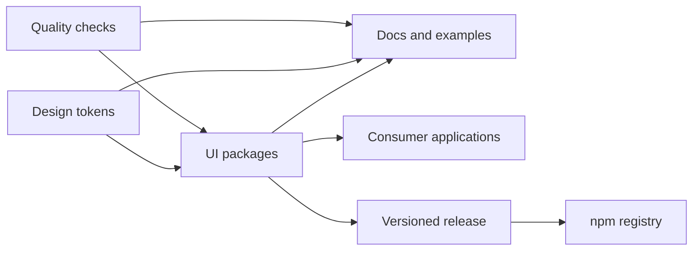

# Tổng quan kiến trúc

## Ranh giới

- **Tokens:** giá trị thiết kế có tên ngữ nghĩa; không phụ thuộc nghiệp vụ.
- **Core UI:** components, hooks/utilities nếu cần, types và styles công khai.
- **Docs/demo:** hướng dẫn và ví dụ; không trở thành dependency runtime của người dùng.
- **Apps:** sản phẩm tiêu thụ package và sở hữu logic nghiệp vụ.
- **Release pipeline:** build artifact, kiểm tra metadata, provenance và công bố theo quyền tối thiểu.

## Nguyên tắc phụ thuộc

Ứng dụng phụ thuộc package; package không phụ thuộc ứng dụng demo. Tránh circular dependencies và export nội bộ ngoài public entry points. Trước khi chốt monorepo, so sánh chi phí workspace tooling với số package thực tế; không chọn công cụ chỉ vì dự kiến có nhiều package.